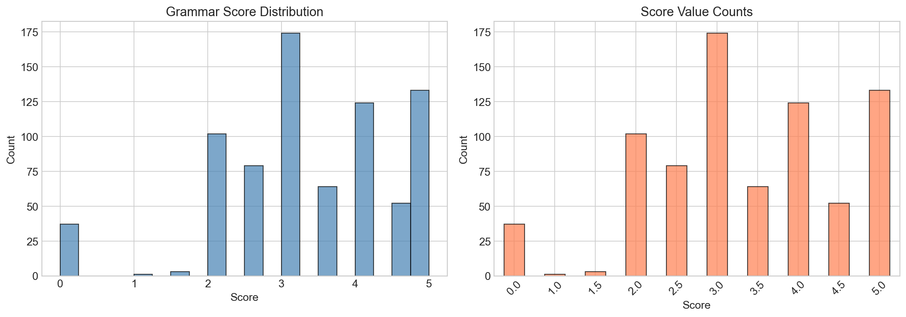
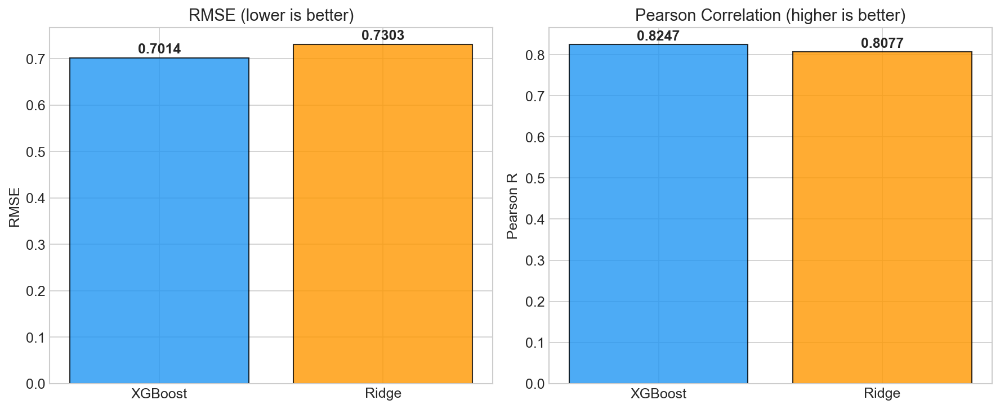
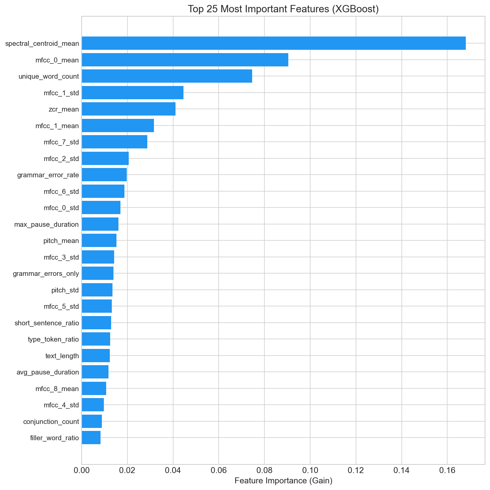
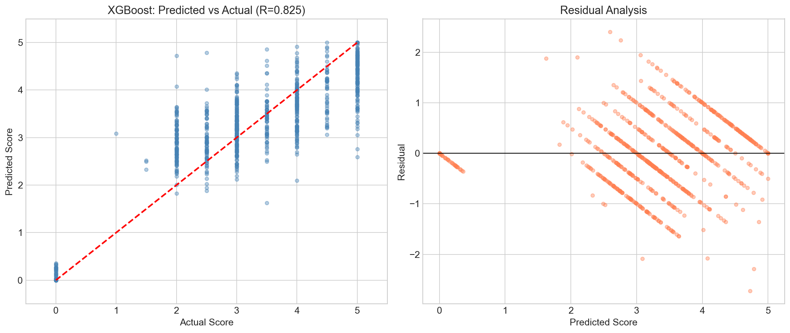

# SHL Grammar Scoring Engine

A Grammar Scoring Engine that evaluates spoken English grammar quality from audio recordings. Built for the [SHL Hiring Assessment 2026](https://www.kaggle.com/competitions/shl-hiring-assessment-2026) Kaggle challenge.

## Problem

Given a spoken audio sample (45–60 seconds, `.wav`), predict a continuous grammar score from **0 to 5** based on the MOS Likert Grammar Score rubric.

## Approach

```
Audio (.wav) → Whisper ASR → Transcript → Feature Engineering → Ensemble Model → Score (0-5)
```

### Pipeline

1. **Speech-to-Text**: Transcribe all 985 audio files using OpenAI **Whisper base** model
2. **Feature Engineering**: Extract **75 features** per sample
   - **32 text features**: grammar errors (via LanguageTool), vocabulary richness, sentence structure, fluency indicators, parts-of-speech counts
   - **43 audio features**: MFCCs (13 × mean + std), pitch, energy (RMS), speaking rate, pause patterns, spectral centroid, zero crossing rate
3. **Model Training**: Train 3 regressors with 5-fold cross-validation
   - XGBoost, LightGBM, Ridge Regression
4. **Ensemble**: Weighted average (inverse-RMSE weighting) of all models

## Results

| Model | RMSE | Pearson R |
|---|---|---|
| **Ensemble** | **0.7167** | **0.8159** |
| XGBoost | 0.7313 | 0.8070 |
| LightGBM | 0.7400 | 0.8019 |
| Ridge | 0.7540 | 0.7934 |

*Evaluated using 5-fold cross-validation on the training set (769 samples).*

### Top 5 Most Important Features (XGBoost)

| Feature | Importance | Description |
|---|---|---|
| `spectral_centroid_mean` | 0.168 | Average brightness of voice signal |
| `mfcc_0_mean` | 0.090 | Mean vocal energy/loudness |
| `unique_word_count` | 0.075 | Vocabulary diversity |
| `mfcc_1_std` | 0.045 | Variation in spectral slope |
| `zcr_mean` | 0.041 | Zero crossing rate (speech vs noise) |

## Dataset

- **Training**: 769 audio samples with grammar scores (0–5)
- **Testing**: 216 audio samples (predictions required)
- **Evaluation**: Pearson Correlation + RMSE

> Dataset is not included in this repo. Download from the [Kaggle competition page](https://www.kaggle.com/competitions/shl-hiring-assessment-2026).

## Project Structure

```
├── notebook.ipynb            # Main notebook: full pipeline end-to-end
├── feature_extraction.py     # Feature extraction module (75 features)
├── transcribe_audio.py       # Whisper transcription script
├── requirements.txt          # Python dependencies
├── README.md                 # This file
│
├── *.png                     # Visualizations
│   ├── label_distribution.png
│   ├── feature_correlations.png
│   ├── correlation_heatmap.png
│   ├── model_comparison.png
│   ├── predicted_vs_actual.png
│   ├── residual_analysis.png
│   ├── feature_importance.png
│   └── test_predictions.png
│
└── Dataset_Final/            # Dataset (not tracked in git)
    ├── train.csv
    ├── test.csv
    ├── sample_submission.csv
    ├── train/                # 769 training .wav files
    └── test/                 # 216 test .wav files
```

## Setup

```bash
# Create conda environment
conda create -n shl python=3.10 -y
conda activate shl

# Install dependencies
pip install -r requirements.txt

# Transcribe audio files (takes ~1 hour on CPU)
python transcribe_audio.py

# Run the notebook
jupyter notebook notebook.ipynb
```

## Visualizations

| | |
|---|---|
|  |  |
|  |  |

## Author

Saurav Singh
